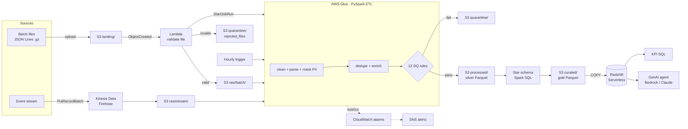

# Last-Mile Delivery Analytics Pipeline

An end-to-end data engineering project for a **last-mile delivery (Delivery Service Partner) program**:
raw delivery events are ingested into an **S3 data lake**, cleaned and validated with **PySpark on AWS Glue**,
modelled as a **Redshift star schema**, and queried by a **GenAI analytics agent** that turns business
questions into guarded, read-only SQL.

Everything runs locally on a laptop (Spark + DuckDB as a Redshift stand-in), and the same code deploys to AWS
with one CloudFormation stack.

| | |
|---|---|
| **Scale tested** | 1,120,188 raw events → 1,096,574 warehouse rows in ~2 minutes on 2 CPU cores |
| **Data quality** | 12 rule checks, quarantine with reasons, 95% pass-rate circuit breaker (98.87% on the sample run) |
| **Privacy** | driver IDs → salted SHA-256 pseudonyms, phone numbers dropped, postcodes generalised |
| **AWS** | S3, Lambda, Kinesis Data Firehose, Glue, Redshift Serverless, IAM, Secrets Manager, CloudWatch, SNS, EventBridge |
| **Tests** | 80 pytest tests (Spark, DuckDB, moto-mocked AWS), ruff, cfn-lint, GitHub Actions CI |

## Architecture



Data-lake zones: `landing → raw → processed (silver) → curated (gold)`, plus `quarantine/` for anything that
fails validation and `quality_reports/` for a JSON report per batch.

## What each stage does

| Stage | Code | Highlights |
|---|---|---|
| Generate | `generate_data.py` | Realistic DSP delivery attempts (retries, failure reasons, lateness per partner) with **controlled dirty data**: bad timestamps, unknown partners, duplicates, malformed JSON |
| Ingest | `ingest.py`, `aws/lambda_ingest.py` | S3-triggered Lambda checks file type, gzip and required fields; moves files to `raw/` or `quarantine/`; starts Glue |
| Stream | `aws/firehose_producer.py` | Batches of 500 to Firehose with retry of only the failed records (exponential backoff) |
| Transform | `transform.py` | Reads raw as strings (nothing breaks the read), parses 3 timestamp formats, standardises codes, masks PII, de-duplicates, joins master data, derives KPIs |
| Data quality | `quality.py` | 12 rules → `dq_failed_rules` array per record; bad rows quarantined with reasons; batch blocked below 95% pass rate |
| Model | `model.py` | Kimball star schema with Spark SQL: `fact_delivery_attempt` + `dim_date`, `dim_dsp`, `dim_station`, `dim_driver`; deterministic surrogate keys; latest-version dedupe across batches |
| Warehouse | `sql/redshift/`, `warehouse.py` | Redshift DDL (DISTKEY/SORTKEY, DISTSTYLE ALL dims), `COPY ... FORMAT AS PARQUET`, orphan-key reconciliation; DuckDB locally |
| KPIs | `sql/kpis/` | DSP weekly scorecard, station on-time trend (7-day moving average), failure-reason ranking, driver productivity |
| GenAI agent | `agent/` | Text-to-SQL with live schema + glossary, AST guardrails (sqlglot), read-only execution, error-feedback retry, and a **grounding check that flags numbers the LLM cites but the data does not contain** |
| Infra | `infra/cloudformation.yaml` | Encrypted, versioned, TLS-only bucket; least-privilege IAM per service; secrets in Secrets Manager; alarms on DQ pass rate, Glue failures and Lambda errors |

## Results (1M-package sample run)

From [`docs/sample_run/`](docs/sample_run):

```
[generate] 1,120,188 raw events (1,000,000 packages)
[ingest]   5 files accepted, 0 rejected
[etl]      1,109,102 unique events | 1,096,574 valid | 12,528 quarantined | 11,086 duplicates removed | pass rate 98.87%
[load]     dim_date=32, dim_dsp=10, dim_station=8, dim_driver=263, fact_delivery_attempt=1,096,574
```

Every injected defect was caught. For each rule, failures = defects injected by the generator + the 336
malformed JSON lines, minus the handful of rows where two defects landed on the same record (for example a
duplicate whose copy was also truncated: 11,090 duplicates were injected, 11,086 removed as duplicates, and
the other 4 quarantined as unparseable). Cleanable issues (lowercase codes, `dd/MM/yyyy` and epoch
timestamps, padded statuses: ~89k rows) were repaired, not dropped.

On-time delivery by partner ranged from **58.5% (DSP-GARUDA) to 87.0% (DSP-ARROW)**, and first-attempt
delivery success from 87.1% to 94.9%.

## Run it

### Option A: Docker (recommended on Windows)

```bash
docker build -t delivery-pipeline .
docker run --rm -v "%cd%/output:/app/output" delivery-pipeline                       # Windows cmd
docker run --rm -v "$(pwd)/output:/app/output" delivery-pipeline --packages 1000000 --fresh   # macOS/Linux
docker run --rm --entrypoint pytest delivery-pipeline                                  # run the tests
```

Results land in `output/reports/`.

### Option B: Python (Linux, macOS or WSL2)

Needs Python 3.10+ and Java 17+ (for Spark).

```bash
python -m venv .venv && source .venv/bin/activate
pip install -e ".[dev]"
pytest                                                   # 80 tests, ~1 minute
python -m delivery_pipeline.run_pipeline --packages 1000000 --fresh
```

Native Windows Spark also needs `winutils.exe`/`HADOOP_HOME`, so use Docker or WSL2 there.

### Ask the warehouse a question (GenAI agent)

```bash
# Amazon Bedrock
export LLM_PROVIDER=bedrock BEDROCK_MODEL_ID=<a model enabled in your Bedrock console> AWS_REGION=ap-south-1
# or the Anthropic API:  pip install anthropic; export LLM_PROVIDER=anthropic ANTHROPIC_API_KEY=...

python -m delivery_pipeline.agent.cli "Which DSP had the worst first-attempt success rate last week, and why?"
```

The agent prints the SQL it ran, the rows, a short answer, and warnings if the SQL was rejected, the result
looks wrong, or the answer cites numbers that are not in the result.

## Deploy to AWS

```bash
pip install -e .
./scripts/deploy_aws.sh delivery-analytics ap-south-1 you@example.com
```

This packages the code, uploads it, deploys the stack, and drops a sample batch into `landing/`, which
triggers the Lambda, then the Glue job. The script prints the Redshift commands for creating and loading the
star schema. **Glue and Redshift Serverless are billable**: tear everything down with
`./scripts/destroy_aws.sh delivery-analytics ap-south-1`.

## Project layout

```
src/delivery_pipeline/
  generate_data.py  ingest.py  transform.py  quality.py  model.py  etl.py  warehouse.py
  run_pipeline.py   metrics.py  spark_session.py  schemas.py  reference_data.py  config.py
  agent/            llm.py  sql_guard.py  analytics_agent.py  cli.py
  aws/              lambda_ingest.py  firehose_producer.py
jobs/glue_etl_job.py          AWS Glue entry point
sql/redshift/                 star-schema DDL and COPY load
sql/kpis/                     KPI queries (Redshift + DuckDB compatible)
infra/cloudformation.yaml     all AWS resources
scripts/                      deploy / destroy
tests/                        80 tests
docs/DESIGN.md                design decisions and trade-offs
docs/sample_run/              outputs of the 1.1M-event run
```

See [docs/DESIGN.md](docs/DESIGN.md) for why it is built this way.
